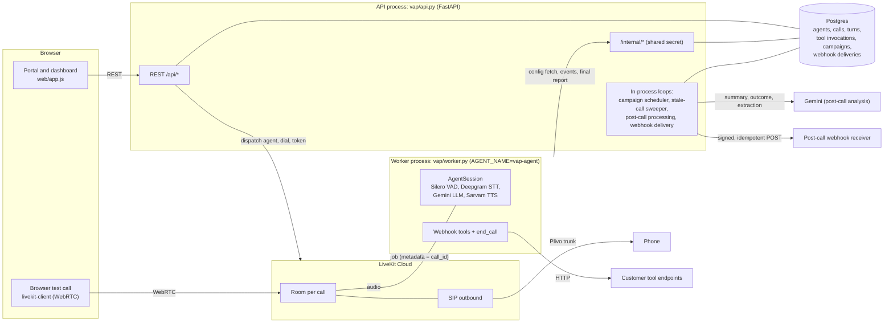
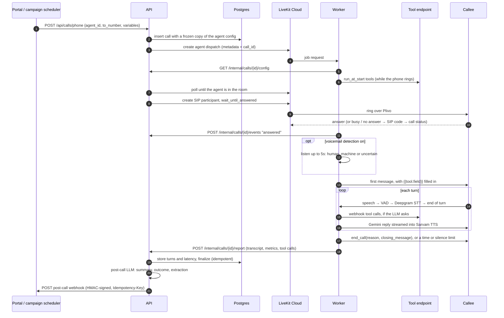

# Voice Agent Platform

Config-driven outbound voice agents on the same infrastructure as the NDR voicebot:
LiveKit Cloud + the Plivo SIP trunk, Deepgram STT, Gemini LLM, Sarvam TTS and Silero VAD.
Creating a new agent is a form in the portal (or a JSON file in `examples/`), with no code change
and no redeploy.

**Contents:** [Setup](#setup) · [Architecture](#architecture) · [How a call flows](#how-a-call-flows-through-the-system)
· [Design decisions and trade-offs](#key-design-decisions-and-trade-offs) · [Measured latency](#measured-latency)
· [Cost per minute](#cost-per-minute-estimate) · [Known limitations](#known-limitations) · [What to build next](#what-to-build-next)

## Setup

### Prerequisites

- **Python 3.10–3.14** and [uv](https://docs.astral.sh/uv/).
- **Docker** (Docker Desktop on Windows/macOS) for the local Postgres.
- **A LiveKit Cloud project.** The worker and the API both talk to it.
- **API keys:** Deepgram (STT), Google AI Studio (Gemini) and Sarvam (TTS). An OpenAI key is only
  needed if an agent uses `llm_provider: openai`.
- **Optional, for phone calls:** an outbound SIP trunk in that LiveKit project (the Plivo trunk the
  NDR bot uses). Without one, the platform does browser test calls only.

These steps were run on Windows 11.

### Steps

```bash
git clone https://github.com/rahulkrtiwari07/test-voicebot.git
cd test-voicebot
uv sync                                   # creates .venv with the pinned livekit-agents 1.7.x
cp .env.example .env.local                # fill in keys (same values as NDR_voicebot/ndr-api/.env)
docker compose up -d                      # Postgres 17 on localhost:5434

# terminal 1: API, portal and dashboard
uv run uvicorn vap.api:app --port 8080    # http://localhost:8080

# terminal 2: agent worker
uv run python -m vap.worker dev           # wait for "registered worker {"agent_name": "vap-agent" ...}"
```

Run the tests with `uv run pytest`: 57 tests, on SQLite, with no network access needed.

### Environment variables

`.env.local` is read first, then `.env`. The API and the worker read the same file.

| Variable | Needed for | Notes |
|---|---|---|
| `LIVEKIT_URL`, `LIVEKIT_API_KEY`, `LIVEKIT_API_SECRET` | every call | Same LiveKit project as the NDR bot. |
| `SIP_TRUNK_ID` | phone calls and campaigns | The LiveKit outbound trunk ID (`ST_…`). Leave it blank for browser calls only. |
| `AGENT_NAME` | every call | Defaults to `vap-agent`. The API and worker must agree. |
| `DEEPGRAM_API_KEY`, `GOOGLE_API_KEY`, `SARVAM_API_KEY` | the worker and post-call | `OPENAI_API_KEY` only for OpenAI agents. |
| `DATABASE_URL` | the API | Defaults to the compose Postgres. `sqlite:///./vap.db` also works for a quick local try. |
| `PLATFORM_API_URL` | the worker | Where the worker reaches the API's `/internal/*` endpoints. |
| `INTERNAL_API_SECRET` | the API and worker | Shared secret on `/internal/*`. Must match on both sides. |
| `POSTCALL_MODEL` | post-call | Defaults to `gemini-2.5-flash`. |
| `MAX_CONCURRENT_CALLS` | campaigns | Defaults to 4, under the LiveKit Build plan's 5 concurrent sessions. |

### Check that it works

1. `curl http://localhost:8080/api/health` returns `{"ok":true,"telephony":true}`. `telephony` is
   `false` when `SIP_TRUNK_ID` is empty.
2. The worker log shows `registered worker` with `agent_name: vap-agent` and your LiveKit region.
3. In the portal, go to **Agents → New from template → Cynet Health reference check**, save it, and
   click **Start call**. Choose the browser call, enter `C-1001` as the candidate ID, and allow the
   microphone.
4. After hanging up, the call page shows the transcript, summary, extracted fields, per-turn
   latency and the webhook delivery. The webhook goes to the built-in receiver at `/demo/webhook-receiver`.

### Troubleshooting

| Symptom | Cause |
|---|---|
| `could not start agent: url must be set` | `LIVEKIT_URL` is not set where the API runs. |
| `SIP_TRUNK_ID is not configured — use a browser test call` | Expected without a trunk. |
| Call stays "in progress" and the worker log shows no `received job request` | `AGENT_NAME` differs between the API and the worker, or the worker is not running. |
| Worker logs `could not fetch config for call …` | `PLATFORM_API_URL` or `INTERNAL_API_SECRET` is wrong on the worker side. |
| `sqlite3.OperationalError: unable to open database file` | The directory in a SQLite `DATABASE_URL` does not exist. |
| A template's tools fail with connection errors | Templates point their demo tools at the URL the portal was opened from (`$PLATFORM_URL`), so the worker must be able to reach that host. |

There are no migrations: the schema is created on startup. After an upgrade, start with a fresh
database (`docker compose down -v`).

## Architecture



| Component | Files | Responsibility |
|---|---|---|
| Portal and dashboard | `web/` | Agent CRUD, test calls, campaigns, call log and call detail. Plain JS, served by the API, no build step. |
| API | `vap/api.py`, `vap/calls.py`, `vap/telephony.py` | Validates agent configs, creates calls, dispatches the worker, dials over SIP, and records the worker's report. |
| Worker | `vap/worker.py`, `vap/providers.py`, `vap/runtime.py` | One generic runtime. It builds the STT → LLM → TTS session and tools from the call's config snapshot. |
| Post-call | `vap/postcall.py`, `vap/webhooks.py` | One LLM call for summary, outcome and extraction, then the post-call webhook. |
| Campaigns | `vap/campaigns.py` | CSV contacts, a concurrency limit, and retries. All state is in Postgres. |
| Schemas and storage | `vap/schemas.py`, `vap/db.py` | Pydantic `AgentConfig` and SQLAlchemy models. |

The worker registers as `vap-agent`, not the NDR bot's `my-agent`, so the two never pick up each
other's jobs on the shared LiveKit project.

## How a call flows through the system



Step by step:

1. **Create.** `POST /api/calls/phone` checks that every `{{variable}}` the agent uses has a value,
   then stores the call with a snapshot of the agent's config. Editing the agent later never
   changes a call in progress.
2. **Dispatch before dialing.** The API dispatches `vap-agent` into a fresh room `vap-phone-<id>`
   and polls until the agent has joined (up to 15s). Only then does it dial, so a customer is never
   rung into an empty room.
3. **Worker setup.** The job metadata holds only the `call_id`. The worker fetches the snapshot from
   `/internal/calls/{id}/config`. It builds the session from it: STT, LLM, TTS, VAD, barge-in
   settings, each configured webhook tool as an LLM function, and the built-in `end_call` tool.
4. **Start-of-call tools.** Tools marked `run_at_start` run as soon as the job starts, in parallel
   with the ringing. Their results go into the LLM instructions and fill `{{tool.field}}`
   placeholders in the first message.
5. **Dial.** `create_sip_participant(wait_until_answered=True)` goes through the Plivo trunk. A
   failure comes back with the carrier's SIP code: 486/600 become `busy`; 480/404/408/410/484/487
   become `no_answer`; 403/603 become `rejected`; anything else is `failed`.
6. **Answer.** The worker waits for `sip.callStatus == active`, which means real pickup and not just
   ringing. It reports `answered` and starts the max-duration timer. With voicemail detection on,
   it listens first (see [voicemail handling](#stretch-goals-campaigns-and-voicemail-handling)).
7. **Conversation.** Each turn runs VAD, then Deepgram streaming STT, then end-of-turn detection,
   then Gemini (streaming), then Sarvam TTS. The caller can interrupt the agent (barge-in). A cough
   or noise counts as a false interruption, and the agent resumes after it.
8. **Ending.** The call ends in one of these ways:
   - the LLM calls `end_call` and its closing line is spoken without allowing interruptions;
   - the max duration triggers a one-sentence spoken wrap-up;
   - two silences in a row (12s each) lead to a check-in, then a hang-up;
   - the caller hangs up.

   In every case the room is deleted.
9. **Report.** On shutdown the worker posts the transcript, per-turn metrics and tool calls. The
   API stores them once (`finalized_at`), and computes voice-to-voice latency per turn. If the
   report never arrives, a sweeper marks the call `failed` 180s after its max duration.
10. **Post-call.** One Gemini call returns the summary, outcome and extraction. Each field is
    validated individually. Then the `call.completed` webhook is sent from a delivery row, with
    retries and backoff.

A **browser test call** follows the same path, except that in step 5 the API returns a LiveKit
token. The browser joins the room as `web-caller` instead of the API dialing.

## The Cynet Health reference-check agent

It lives in `examples/cynet_reference_check.json`, and in the portal it's **Agents → New from
template → Cynet Health reference check**. It is pure configuration:

- **Start-of-call tool.** `get_candidate_details(candidate_id)` is a webhook tool with
  `run_at_start: true`. The platform calls it while the phone is still ringing (no latency after
  pickup) and gives the result to the LLM before its first turn. The first message names the
  candidate through `{{get_candidate_details.name}}`. If the tool fails, that placeholder can't
  be filled, so the worker lets the LLM open instead. The mock endpoint is
  `/demo/tools/candidate-details` (IDs C-1001 to C-1003).
- **Questions and callback.** The prompt runs the six questions one at a time. A busy reference
  is offered a callback, and the agent confirms the preferred time before ending the call.
- **Extraction schema.** Exactly the spec's fields:
  - `strengths` and `improvements` use the new `string[]` type;
  - `rating` is an integer bounded 1–5, so a 7 or 4.5 is a validation error;
  - `would_rehire` is an enum of yes / no / unsure.

  `dates_match_claim` is judged against the tool result, because post-call analysis sees tool
  calls and their results interleaved in the transcript.
- **Outcome labels.** completed, callback_requested, declined, wrong_number, voicemail, failed.
  Calls decided without an LLM (no answer, busy, voicemail) map onto the agent's own labels: a
  no-answer becomes `failed` for this agent.
- **Call variables.** `reference_name` and `candidate_id`, filled per call or per CSV row.

## How each requirement is met

| Requirement | Where |
|---|---|
| **1. Portal**: agent CRUD with name, prompt, first message, LLM provider/model, TTS voice, language, max duration, end-call conditions, extraction schema, tools | `web/app.js`; `/api/agents`. Validated by `AgentConfig` (`vap/schemas.py`) and, for the Sarvam voice/model pairing, by the plugin's own table (`vap/providers.py`). Soft delete keeps call history. Templates are served from `examples/*.json`. |
| **2. Call runtime**: outbound phone call, browser fallback | `POST /api/calls/phone` dispatches the agent, waits for it to join, then dials over the SIP trunk with `wait_until_answered`. SIP codes map to busy / no_answer / rejected. `POST /api/calls/web` returns a LiveKit token for a WebRTC test call. |
| Streaming STT → LLM → TTS | One generic `AgentSession` built from config (`vap/providers.py`). Providers: google / openai / LiveKit Inference for the LLM; sarvam / deepgram / inference for TTS. |
| Barge-in | `turn_handling.interruption` with false-interruption resume. Interrupted agent turns are stored truncated and flagged `interrupted`. |
| Agent ends the call itself | Built-in `end_call(reason, closing_message)` tool driven by the end-call conditions. A max-duration timer forces a spoken wrap-up. Silence gets one check-in, then a hang-up. |
| **3. Webhook tools** | Each configured tool becomes an LLM function from its JSON schema (`make_webhook_tool`). The response is handed to the LLM. Timeouts, non-2xx responses and connection errors return `{"ok": false, ...}`, and the prompt tells the agent to apologize and never invent the result. Tools can also run at call start (see above). |
| **4. Post-call** | Transcript with speaker labels, timestamps, interrupted flags and per-turn metrics. One LLM call does summary, outcome and extraction (`vap/postcall.py`). Each field is type-checked, coerced and bounds-checked individually, with one repair retry on structural errors; per-field errors are stored, not dropped. |
| Post-call webhook, no duplicates on retry | `vap/webhooks.py`. One row per (call, event), unique constraint, fixed `event_id` and byte-identical body on every attempt. `Idempotency-Key` header plus HMAC `X-VAP-Signature`. Backoff, and a per-row lock against concurrent senders. The worker's report endpoint is idempotent (`finalized_at`). |
| **5. Dashboard** | Call log with status, duration, outcome, agent and avg voice-to-voice latency. Call detail shows summary, extracted data with validation issues, a transcript with tool calls interleaved (start-of-call ones badged), per-turn latency, and webhook deliveries with resend. |

## Key design decisions and trade-offs

| Decision | Why | Trade-off |
|---|---|---|
| **One generic worker, agents as data.** The worker has no agent-specific code; each call carries a frozen config snapshot. | A new agent is a form, not a deploy. A call is reproducible from its row, and editing an agent can't change a live call. | Anything the config schema can't express (custom logic between turns, multi-agent handoff) needs a platform change. |
| **Job metadata is just `call_id`; the worker fetches config from the API.** | The config, and its secrets in tool headers, never pass through LiveKit. One source of truth. | One extra HTTP hop at job start, retried 3 times. If the API is down, calls fail to start. |
| **Pipeline (STT → LLM → TTS), not a speech-to-speech model.** | Sarvam has the Indian voices and Hindi the NDR bot needs. Each stage can be swapped and measured, and transcripts and tool calls are first-class. | About 2s voice-to-voice. A realtime model can be faster but locks voice, language and tooling to one vendor. |
| **Dispatch the agent, wait for it to join, then dial.** | A customer is never rung into an empty room. Worker capacity problems show up as `agent_did_not_join`, an infrastructure failure that doesn't use the contact's retries. | Adds the agent's join time (polled every 0.5s, up to 15s) before the phone starts ringing. |
| **`wait_until_answered=True` on the SIP dial.** | Busy, no-answer and reject come back as SIP codes, so call status is exact. | The API holds a coroutine for the whole ring time. That's fine for one process, but it's one reason the API is single-instance. |
| **Start-of-call tools run during ringing.** | The first line can name the candidate with no delay after pickup. | The tool runs even when nobody answers, so endpoints with side effects see calls for unanswered dials. |
| **Gemini 2.5 Flash with `thinking_budget=0`, plus preemptive generation.** | In the NDR bot, thinking leaked into speech and added latency. Preemptive generation starts the LLM before end-of-turn is final. | Less reasoning per turn. Preemptive drafts that get thrown away still cost tokens. |
| **Our own VAD-based voicemail detection, not LiveKit's.** | LiveKit's detector read silent frames on SIP tracks in NDR testing. A VAD heuristic is simple and transparent. | The agent stays quiet for up to 5s (or until a short "Hello?" plus a 0.5s pause) before greeting. The thresholds are tuned on WebRTC, not real carrier audio. Calling a person a machine is the worse error, so ambiguous cases count as a person. |
| **One post-call LLM call, then per-field validation.** | Summary, outcome and extraction share one read of the transcript: cheaper, and the three stay consistent. A bad field is nulled and reported, not the whole result. | One prompt carries three jobs. A very long call or schema could crowd the output; there's one repair retry. |
| **Webhooks via an outbox row with a unique (call, event) key.** | Retries, restarts and manual resends can never create a second event, and each retry is byte-identical, signed with the same `Idempotency-Key`. | Delivery is at-least-once, so receivers still need to dedupe on `Idempotency-Key`. |
| **Idempotent worker report, a sweeper, and a local fallback file.** | A lost response or a retry can't double-record a call, and a crashed worker can't leave a call open forever. | If the API is down for all of the worker's report retries, the transcript sits in `worker_failed_reports.jsonl` and isn't replayed automatically. |
| **Separate retry budgets: the contact's attempts vs our infrastructure failures.** | Our bad day (trunk 5xx, worker crash) shouldn't use up a contact's retries. Same split as ndr-api. | Two counters to explain in the UI and reason about. |
| **Postgres, schema created at startup, no migrations.** | Fast to iterate. Tests run the same models on SQLite. | Upgrades need a fresh database. |
| **One API process with in-process background loops.** | No queue or broker to run. The scheduler, sweeper, post-call and webhooks all restart from database state. | No horizontal scaling: two API instances would both schedule campaigns. |
| **Plain JS portal served by FastAPI.** | No build step, one origin, nothing to deploy separately. | No component framework or typed client. It is fine at this size but won't scale to a large UI. |

## Measured latency

**Definition.** Voice-to-voice latency is the time from the caller stopping speaking to the agent
starting to speak. In LiveKit's speech timestamps, that's agent `started_speaking_at` minus the
latest user `stopped_speaking_at` since the previous agent turn. This is the same definition as
LiveKit's `e2e_latency`, which is used when present. LiveKit only computes that from the *last*
user message, though, and it sometimes splits one utterance into two messages where the second has
no timestamp, which left most replies blank in live testing (`runtime.voice_to_voice_ms`).
Check-ins and wrap-ups the platform triggers itself are not replies and are excluded.

**Results.** Measured on the full reference-check call: LiveKit Cloud India South, browser
(WebRTC) caller, Gemini 2.5 Flash, Sarvam Bulbul v3, Deepgram Nova-3.

| Measure | Value |
|---|---|
| Voice-to-voice, average over the call | about 2.0s |
| Voice-to-voice, worst turn | about 3.0s |
| Gemini 2.5 Flash time to first token | about 1.0s |
| Sarvam TTS time to first audio | about 0.2s |
| Start-of-call tool (`get_candidate_details`, local mock) | about 30ms, during ringing, so 0s after pickup |

That run didn't break out the remaining ~0.8s individually. It covers end-of-turn detection
(endpointing waits 0.3–1.5s), STT finalization and network hops. The LLM is the largest single
stage.

**Where to see it.** For each call, the dashboard shows the average and worst voice-to-voice
latency. For each agent turn it shows `v2v_ms`, `llm_ttft_ms` and `tts_ttfb_ms`; for each user
turn, `end_of_turn_ms` and `transcription_ms`.

**Not measured yet:** voice-to-voice over a real PSTN call. Carrier and SIP transcoding will add to
the WebRTC numbers.

## Cost per minute estimate

This is an estimate for one minute of a connected outbound phone call to an Indian mobile number,
with the reference-check agent's stack. Prices are list prices checked on 23 Oct 2026, at
₹88 = $1.

Usage assumptions:
- the agent speaks about 400 characters a minute;
- there are about 5 LLM requests a minute, each with about 2,300 input tokens and 40 output tokens.
  The prompt plus tool schemas is about 1,300 tokens, plus the growing history.

| Item | Price | Per minute |
|---|---|---|
| LiveKit Cloud agent session | $0.01/min over the included minutes | $0.010 |
| LiveKit third-party SIP minutes | $0.004/min (Ship), $0.003/min (Scale) | $0.004 |
| Plivo termination to India | ₹0.38–0.60/min, billed in 60-second increments | $0.004–0.007 |
| Deepgram Nova-3 streaming STT | $0.0048/min (promo), $0.0077/min (list) | $0.005–0.008 |
| Gemini 2.5 Flash, conversation | $0.30 per 1M input tokens, $2.50 per 1M output tokens | about $0.004 |
| Gemini 2.5 Flash, post-call analysis | one request per call, spread over its minutes | under $0.001 |
| Sarvam Bulbul v3 TTS | ₹3 per 1,000 characters | about $0.014 |
| **Total** | | **about $0.041–0.047/min (₹3.6–4.1/min)** |

What this means in practice:
- **Typical call:** a 5-minute reference check costs about $0.21–0.24 (₹18–21).
- **TTS is the largest item,** about a third of the total. It scales with how much the agent says,
  so shorter agent turns are the cheapest lever.
- **Browser test calls** have no SIP or Plivo cost: about $0.03/min.
- **Calls that don't connect** cost close to nothing. A no-answer only uses agent-session time
  while ringing, plus any start-of-call tool calls.
- **Plivo bills India routes per started minute,** so a 61-second call is billed as 2 minutes on
  that line.
- **Free tier:** LiveKit's free Build plan includes 1,000 agent-session minutes and 1,000 SIP
  minutes a month, so low-volume testing pays only the model and carrier lines.
- **Not counted:** noise cancellation (BVC), WebRTC participant minutes and monthly plan fees.
- **Check before relying on these:** Deepgram's rate is promotional, and Plivo's India pages list
  both ₹0.38 and ₹0.60. Your trunk's own rate sheet is authoritative.

Price sources: [LiveKit](https://livekit.com/pricing), [Deepgram](https://deepgram.com/pricing),
[Gemini API](https://ai.google.dev/gemini-api/docs/pricing), [Sarvam](https://www.sarvam.ai/api-pricing),
[Plivo SIP trunking, India](https://www.plivo.com/sip-trunking/pricing/in/).

## Stretch goals: campaigns and voicemail handling

**Campaigns** (`vap/campaigns.py`, **Campaigns** tab):
- **Contacts:** upload a CSV with a phone column plus one column per call variable (a sample is in
  `examples/reference_contacts.csv`). Bad numbers, duplicates and rows missing a variable are
  rejected per row and listed.
- **Concurrency:** limited per campaign and by a global `MAX_CONCURRENT_CALLS` (default 4, under
  LiveKit's 5-session Build-plan cap), shared across campaigns.
- **Retries:** no-answer, busy, rejected and voicemail count against the contact's `max_attempts`
  and are retried after the configured delay.
- **Infrastructure failures don't use the retry budget.** A call that ended `failed` without
  ever being answered (agent never joined, trunk or carrier 5xx, dial error, worker died before
  pickup) is our failure, not the contact's. It counts against a separate `max_infra_attempts`
  budget (5, retried after 60s), the same split ndr-api makes with `dial_attempted`.
- **Restarts:** all state is in the database (contact status, attempts, `next_attempt_at`), and
  applying a result is idempotent, so a restart or a repeated hook can't double-count.
- **Scope:** pause and resume are supported. A single API instance is assumed.

**Voicemail handling** (agent setting):
- **Detection:** when enabled, the agent listens briefly after pickup before speaking. A short
  "Hello?" followed by a pause is a person; continuous speech of 2.5s or more is a recorded
  greeting; silence for 5s is treated as a person.
- **Why not LiveKit's built-in detection:** this is the NDR bot's heuristic. LiveKit's built-in
  answering-machine detection read silent audio on SIP tracks there.
- **Action on voicemail:** hang up, or wait for the greeting and beep to finish and leave the
  configured message. The message supports `{{variables}}` and `{{tool.field}}`.
- **Result:** the call gets status `voicemail` and outcome `voicemail` (no LLM call), and
  campaigns retry it.

## Verified live (LiveKit Cloud, India South)

All of these ran through the real worker, Gemini, Sarvam and Deepgram, with a headless WebRTC
caller speaking lines synthesized by Deepgram TTS.

- **Reference check, full:**
  - The start tool ran in about 30ms, and the first message named "Priya Nair".
  - The six questions were asked, and the agent ended the call itself.
  - Extraction was correct: `dates_match_claim: true`, `would_rehire: yes`, `rating: 5`,
    strengths and improvements as lists.
  - The webhook was delivered once.
  - Voice-to-voice averaged about 2.0s (worst 3.0s). See [Measured latency](#measured-latency).
- **Reference check, busy:** callback offered and confirmed, outcome `callback_requested`,
  `callback_time: "tomorrow, Friday, October 23rd, at 3 PM"`.
- **Voicemail:** a long greeting plus beep was detected as a machine. The agent left the message,
  naming the candidate from the start tool, and the call was labeled `voicemail`.
- **Earlier agents:**
  - tool success with barge-in;
  - a tool timing out after 3s, with a graceful apology;
  - a silent caller (check-in, then hang-up);
  - a 15s max-duration limit.
- **Portal:** every route loaded in headless Chromium (Playwright) with no JavaScript errors:
  template → save, invalid-voice rejection, start-call variables, call detail, campaign form.

Not tested live:
- **A real PSTN call or a live campaign.** Both need real numbers to ring. Campaign scheduling,
  concurrency and both retry budgets are covered by tests with faked telephony.
- **Voicemail detection on a real phone line.** It was tested over WebRTC only; real carrier audio
  and greetings will need threshold tuning.

## Known limitations

- **No portal auth.** Anyone who can reach port 8080 can create agents and place calls. This
  would be the next stretch goal (login plus workspaces).
- **Tool and webhook URLs are called from the worker and API hosts.** If those hosts can reach
  internal services, restrict the URLs (SSRF).
- **No real PSTN validation yet.** Phone-call latency, voicemail thresholds on carrier audio and the
  real per-minute cost are unmeasured (see above).
- **Single API instance.** The campaign scheduler, sweeper, post-call processing and webhook
  retries run inside the API process. Running two copies would double-schedule campaigns.
- **No migrations.** The schema is created on startup, so an upgrade needs a fresh database.
- **Lost worker reports aren't replayed.** If the API is unreachable for all of the worker's report
  retries, the report is written to `worker_failed_reports.jsonl` and the sweeper later marks the
  call `failed`. Its transcript is only in that file.
- **Hanging up a browser test call before the browser joins** records the call as
  `agent_error:RuntimeError` with a traceback in the worker log, rather than a clean "cancelled"
  reason. The room is deleted while the worker is still waiting for the caller.
- **The Sarvam plugin's voice list can lag Sarvam's API.** `amelia` passed the plugin check but
  the API rejected it. The worker now ends and reports such calls immediately as `agent_error:…`
  instead of leaving them open.
- **Manual calls don't count toward the campaign concurrency cap.** Only campaign calls are
  limited by it.
- **`python -m vap.worker dev` prints a deprecation warning** on livekit-agents 1.7.1; LiveKit now
  points to `lk agent dev`. It still works.
- **Demo endpoints (`/demo/*`) are in-memory** sample tools and a webhook receiver.

## What to build next

In priority order:

1. **Validate on real phone lines.** Run a small pilot over the Plivo trunk. Measure PSTN
   voice-to-voice latency and the real cost per minute, and tune the voicemail thresholds on
   carrier audio and real greetings.
2. **Auth and safety.** Portal login with workspaces, per-workspace API keys, and an allowlist for
   tool and webhook URLs (SSRF). Campaigns also need calling-hour windows and a do-not-call list.
3. **Cut latency below 1.5s.**
   - Report p50 and p95 per stage, not just averages.
   - Try a smaller or faster LLM per agent; the provider is already a config field.
   - Tighten endpointing per agent.
   - Say a short acknowledgement while a slow tool runs.
4. **Make operations robust.**
   - Alembic migrations.
   - Move the scheduler, sweeper and webhook delivery behind a leader lock or a queue, so the API
     can run more than one instance.
   - Replay `worker_failed_reports.jsonl` on startup.
   - Give pre-join hang-ups a clean end reason.
5. **Cost per call in the dashboard.** Record minutes, TTS characters and LLM tokens on each call
   and show the cost next to latency, so expensive prompts are visible.
6. **Regression tests for agents.** Use the headless WebRTC caller from the live tests as a
   scripted simulated caller in CI, and check outcomes and extraction for each template after
   prompt or model changes.
7. **Call recording and inbound calls.** Use LiveKit Egress for recordings, with playback on the
   call detail page, and add inbound SIP so the same agents can answer calls.
